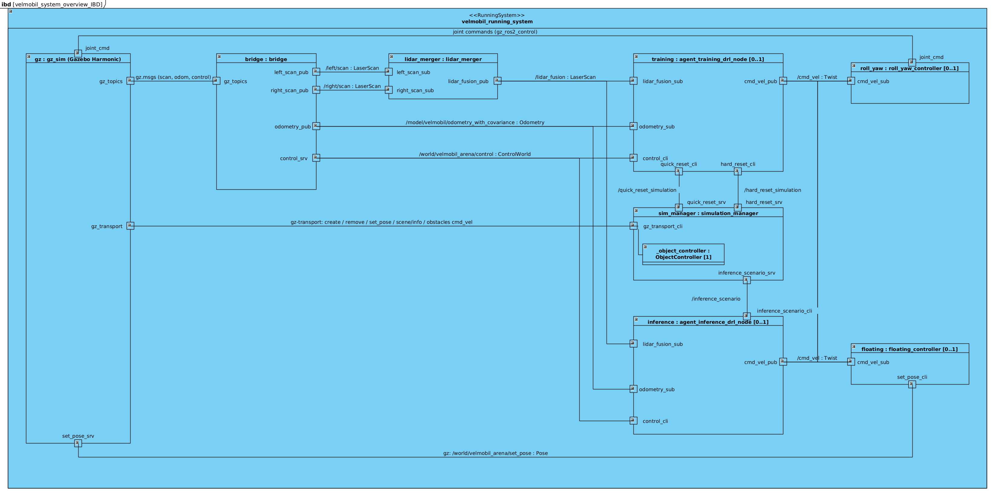

# Documentation

Describes how the repository is organised and how its main parts work together.
For build and run instructions see [INSTRUCTION.md](INSTRUCTION.md).
SysML diagrams of the system (MeROS convention) are in [`velmobil_diagrams/VELMOBIL.vpp`](velmobil_diagrams/VELMOBIL.vpp).

## Repository structure

Only the most important files are listed.

```bash
VELMOBIL_Troszczynski_Piecha/
├── velmobil_agent
│   ├── config
│   │   ├── inference_params.yaml
│   │   └── training_params.yaml
│   ├── launch
│   │   ├── inference.launch.py
│   │   └── training.launch.py
│   ├── obstacles
│   │   ├── dynamic_obstacles
│   │   └── static_obstacles
│   ├── plots
│   ├── trained_policies
│   └── velmobil_agent
│       ├── common
│       │   ├── logs_creators.py
│       │   ├── Model.py
│       │   ├── preprocessing.py
│       │   └── RobotStateData.py
│       ├── inference
│       │   ├── AgentInferenceDRL.py
│       │   ├── agent_inference.py
│       ├── simulation
│       │   └── SimulationManager.py
│       └── training
│           ├── AgentTrainingDRL.py
│           ├── agent_training.py
│           └── reward_function.py
├── velmobil_description
│   ├── control_config
│   │   ├── floating_velmobil.yaml
│   │   └── roll_yaw_velmobil.yaml
│   ├── controller
│   │   ├── include
│   │   │   ├── floating_controller.hpp
│   │   │   └── roll_yaw_controller.hpp
│   │   ├── floating_controller.cpp
│   │   └── roll_yaw_controller.cpp
│   ├── models
│   ├── urdf
│   │   ├── macros.urdf.xacro
│   │   ├── properties.urdf.xacro
│   │   └── velmobil.urdf.xacro
├── velmobil_diagrams
│   └── VELMOBIL.vpp
├── velmobil_interfaces
│   └── srv
│       ├── InferenceScenario.srv
│       └── StageModification.srv
├── velmobil_simulation
│   ├── launch
│   │   └── simple_velmobil.launch.py
│   ├── rviz
│   │   └── basic.rviz
│   └── worlds
│       ├── models
│       │   ├── velmobil_gym
│       │   ├── velmobil_gym_mini
│       │   └── velmobil_gym_mini_obstacled
│       └── velmobil_arena.sdf
├── Dockerfile
├── docker_launcher.sh
├── DOCUMENTATION.md
├── INSTRUCTION.md
└── README.md
```

## Packages

| Package | Purpose |
|---|---|
| `velmobil_agent` | Nodes for DRL training and inference / simulation manager |
| `velmobil_interfaces` | Custom interfaces |
| `velmobil_simulation` | Gazebo world, LiDAR fusion, simulation launch file |
| `velmobil_description` | ros2_control controller plugins and URDF/xacro for velmobil |

### Executables in `velmobil_agent` package

| Executable | Node name | Description |
|---|---|---|
| `agent_training_drl` | `agent_training_drl_node` | Trains policy, it is also a `gymnasium.Env` |
| `agent_inference_drl` | `agent_inference_drl_node` | Runs a trained policy and evaluates it stage by stage |
| `manage_simulation` | `simulation_manager` | Spawns obstacles and teleport the robot, start and goal to random place in provided range|

### Custom controllers

| Controller | Description |
|---|---|
| `roll_yaw_controller/RollYawController` | Default. Simulates each mecanum wheel corner with a steered (yaw) and driven (roll) joint pair |
| `floating_controller/FloatingController` | Motion model that moves the robot by teleporting it in Gazebo |

Both controllers subscribe to `/cmd_vel` topic.

## System overview

<p align="center">
  
</p>

- **Sensors:** two 2D LiDARs (left and right) are merged by `ira_laser_tools/laserscan_multi_merger` into one scan on `/lidar_fusion`.
- **Lockstep simulation:** the agent pauses Gazebo and advances it with the `ControlWorld` service by 11 physics steps (11 × 0.01 s = 0.11 s of simulated time) per agent step, so training is not tied to real time.
- **Scenario control:** `simulation_manager` talks to Gazebo directly through gz-transport to spawn / remove obstacles and to move the robot / start/goal markers.

### Services

| Service | Type | Server | Client | Purpose |
|---|---|---|---|---|
| `/quick_reset_simulation` | `std_srvs/Trigger` | simulation_manager | training agent | Move velmobil back to the current start |
| `/hard_reset_simulation` | `velmobil_interfaces/StageModification` | simulation_manager | training agent | Randomize new start & goal, stage reroll or stage up |
| `/inference_scenario` | `velmobil_interfaces/InferenceScenario` | simulation_manager | inference agent | Prepare the next evaluation trial |
| `/world/velmobil_arena/control` | `ros_gz_interfaces/ControlWorld` | Gazebo (via bridge) | both agents | Pause and step the simulation |

### Action

| Action | Type | Server | Client |
|---|---|---|---|
| `/navigate_to_pose_drl` | `nav2_msgs/NavigateToPose` | inference agent | inference agent (evaluation loop) |

## Velmobil Agent package setup

| Item | Value |
|---|---|
| Observation | 95 values: 90 preprocessed LiDAR ranges + normalized goal distance, normalized bearing, `vx`, `vy`, `omega` |
| LiDAR preprocessing | 360 ranges -> `MinPooling` to 90 -> `IPAPRecN` |
| Action | 3 values in `[-1, 1]` -> `vx`, `vy`, `omega` published on `/cmd_vel` |
| Agent step | 0.11 s of simulated time |
| Episode end | goal reached (distance < `goal_tolerance`), collision (any range < `COLLISION_RANGE`) or `max_steps_per_episode` |
| Reward | selected by `reward_function_class_name` from `training/reward_function.py` |

### Curriculum and resets while training

Before each episode the agent chooses one of the following resets:

1. **Stage up** when the episode number reaches the next value in `stage_shift_episodes`.
2. **Stage reroll** every `hard_reroll_episode_rate` episodes: new obstacles, start and goal in the current stage.
3. **New start & goal** every `quick_reroll_episode_rate` episodes.
4. **Quick reset** otherwise: the robot returns to the current start.

Stages are defined in the YAML files by the number of static and dynamic obstacles, dynamic obstacle speed range, start-goal distance and goal tolerance.

### Adding a reward function

Create a new subclass of `RewardFunction` in `training/reward_function.py` and set its class name in `training_params.yaml` under `reward_function_class_name`.

## Configuration

| What | Where |
|---|---|
| Training parameters, stages, reward function | `velmobil_agent/config/training_params.yaml` |
| Inference parameters, stages, trials per stage | `velmobil_agent/config/inference_params.yaml` |
| Total timesteps, model save path | `velmobil_agent/velmobil_agent/training/agent_training.py` |
| Policy used for inference | `MODEL_LOAD_PATH` in `velmobil_agent/velmobil_agent/inference/agent_inference.py` |
| Physics step | `max_step_size` in `velmobil_simulation/worlds/velmobil_arena.sdf`. Must match `SIMULATION_STEP_TIME` parameter |

## Outputs

| Output | Location | Content |
|---|---|---|
| Trained policies | `velmobil_agent/trained_policies/` | `<DRL_algorithm_name>_*.zip` |
| Training log | `velmobil_agent/logs/training_logs/<DRL_algorithm_name>_<date>.csv` | One row per episode: `stage`, `start_pos_x`, `start_pos_y`, `goal_pos_x`, `goal_pos_y`, `reward`, `success_rate`, `time_to_goal`, `reached`, `collided`, `outcome` |
| Evaluation log | `velmobil_agent/logs/evaluation_logs/<DRL_algorithm_name>_<date>.csv` | One row per trial: stage parameters, start/goal, `reached`, `time_to_goal`, `outcome`, `goal_tolerance` |

`success_rate` in the training log is a rolling value over the last `SUCCESS_RATE_WINDOW` episodes of the current stage. `SUCCESS_RATE_WINDOW` can be set in `velmobil_agent/velmobil_agent/common/logs_creators.py` file. By default, `SUCCESS_RATE_WINDOW = 100`.
